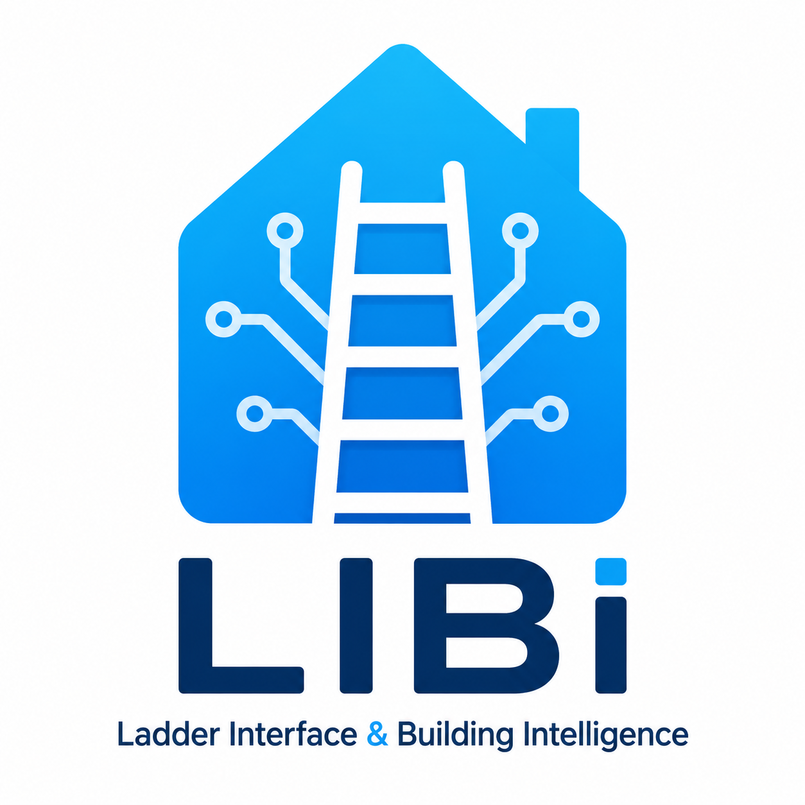
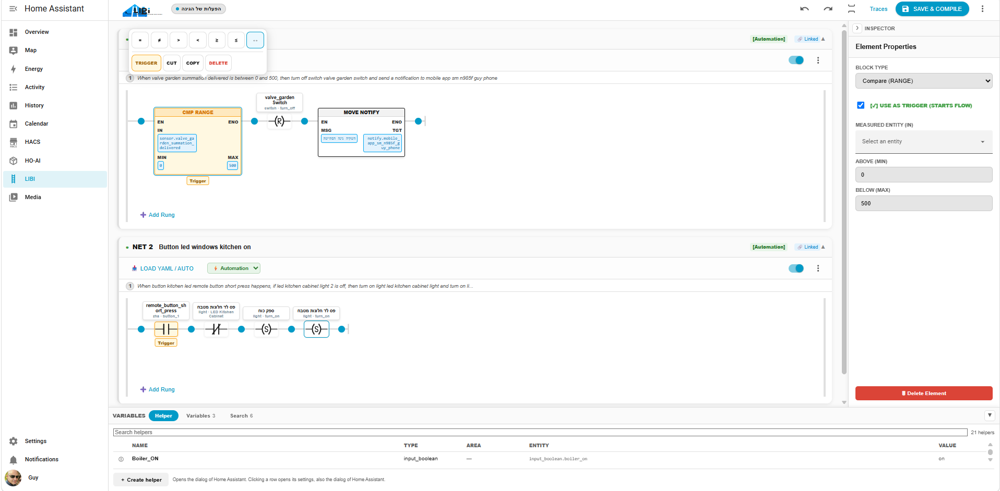
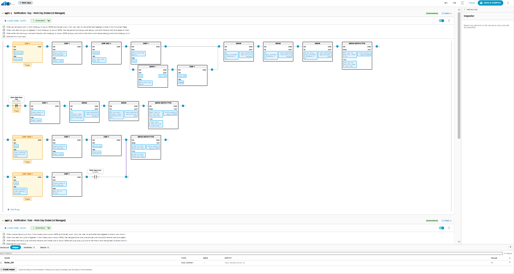

  

# **LIBI (Ladder Interface & Building Intelligence)**

  
  
  

  
  
  
  

## **Why LIBI**

I have been a PLC programmer and IT professional for 25 years.

When I moved my home to Home Assistant, the one thing I really missed was **Ladder logic**: the language I think in when I design control logic. Home Assistant has YAML, the visual editor and Node-RED, but no Ladder. So I built LIBI.

## **Not a Node-RED Replacement**

**Please note:** LIBI is *not* intended to replace Node-RED. It is simply an alternative approach to writing automations in Home Assistant. It is specifically designed for electricians, PLC (Programmable Logic Controller) programmers, or anyone who prefers a straightforward, graphical way to learn and write logic.

## **What is LIBI?**

LIBI is a graphical editor that takes your existing Home Assistant automations and automatically translates them into a LADDER logic representation. It allows you to:

* Add and modify automation logic using a visual interface.  
* Save the resulting logic back to Home Assistant's standard automation, script and scene files - through the same editor API Home Assistant's own automation, script and scene editors use.  
* Execute the automations natively within Home Assistant, just like any standard automation.

### **IEC 61131-3 Compliance**

The software is built upon the **IEC 61131-3** standard, the international standard defining programming languages for PLCs. Specifically, LIBI utilizes:

* **LD (Ladder Diagram):** The classic ladder logic format, adapted with minor deviations to ensure seamless compatibility with Home Assistant's native entities and execution models.

## **Key Features**

* **Integrated Helper Management:** Search for, manage, and insert variables (Helpers) directly from within the graphical editor.  
* **Project and File Grouping:** Save and manage groups of YAML files collectively. In LIBI, every **NET** functions as an individual YAML file. This allows you to open a single project and view all related ladders (e.g., "Garden Automations", "Security Automations") in one unified workspace.
* **Net Versions:** Every NET keeps its earlier versions. When an existing automation is opened in LIBI for the first time, LIBI keeps a copy of it in the version history exactly as it was in Home Assistant - **V1, the original** - and another one as **V2**, the version you work on; a NET you draw from scratch starts at V1. Every **SAVE & COMPILE** that changes a NET records the next version. The **V** badge on a NET shows the version that runs in Home Assistant; click it to see every version with its date and YAML, put an earlier one back on the canvas, and **SAVE & COMPILE** to make it the one that runs. The original is never dropped from the history. A change made in Home Assistant's own editor is recorded as a version the next time the project is opened.
* **SAVE & COMPILE:** LIBI compiles every NET first and checks it with Home Assistant's own validator. When anything does not hold, nothing is saved and LIBI says which NET and why. Otherwise each change goes to Home Assistant, which writes and reloads it, and LIBI waits until Home Assistant has reloaded it before it says it is saved.
* **Deleting a NET** asks what becomes of its automation: **Delete completely** (the automation is deleted from Home Assistant too), **Delete and go back to V1** (the original logic is put back; Home Assistant writes it in its own format, as it does with every save), or **Remove from LIBI only** (the automation stays in Home Assistant as it is now).
* **A save never deletes what you did not ask it to.** An automation you opened from Home Assistant is never deleted by **SAVE & COMPILE**: when it leaves the canvas any other way than **Delete NET** (**Clear all nets**, undo, another automation loaded into its NET, the AI Chat's **Replace**), it stays in Home Assistant as it is and leaves the project, and LIBI says so after the save. Only an automation, script or scene that LIBI itself created for the project can be deleted by a save, and only after LIBI lists it and you choose **Delete** - **Keep in Home Assistant** leaves it there, and **Cancel** saves nothing.
* **A NET you did not change is never written again.** SAVE & COMPILE sends only the NETs you changed in LIBI. An automation you changed in Home Assistant's own editor is left as you changed it, and so is everything in it that the ladder cannot draw. Before a save would do any of the following, LIBI says which automation and asks:
  * put back an automation that was deleted in Home Assistant since LIBI saved it (**Remove its NET** or **Save it again**);
  * replace a change made in Home Assistant since LIBI last saw it (**Replace with my NET**);
  * change a part of an automation that the ladder cannot draw (**Save anyway**).

  **Cancel** saves nothing.
* **A NET never takes another one's place:** a NET whose name or id is already used in Home Assistant by a script or an automation that is not this project's - one of yours, or another LIBI project's - is saved under the next free one (`script.good_night_2`), and the other one is left exactly as it is. The NET keeps that name from then on, even after the other one is gone. A copy of a NET (**Duplicate**) is a new automation of its own, and two NETs can never save to the same automation: LIBI says which two and saves nothing.
* **Nothing is written over a change made while you decide.** Just before each change goes to Home Assistant, LIBI checks it again. If that automation, script or scene changed in the meantime - in Home Assistant's own editor, or from another LIBI page - it is not sent, nor anything after it, and LIBI says so: press **SAVE & COMPILE** again. A LIBI page opened before another page saved the same project saves nothing, and asks you to open the project again, so it never writes over that save.
* **Changes not saved:** closing a project, opening another one or leaving LIBI with changes that are not saved asks whether to save them first.
* **Traces - the online view of a PLC:** press **Traces** in the header (on a phone, in the menu); the **ONLINE** bar opens over the NETs.
  * **Read only:** while Traces is on, a click only follows the run or FORCEs a block. Nothing can be edited - no element added, changed, moved or deleted, no Inspector, no undo, no save, no project opened, no AI draft - and a click on one of those says so. Turn Traces off to edit. The automation's on/off switch still works.
  * **Over each NET**, a monitor shows:
    * the clock now
    * whether its automation is on or off in Home Assistant, and whether it is running
    * its last run
    * the value of every variable it uses; one that is offline is red
  * **Each block** shows:
    * its state
    * **OFFLINE** or **NOT IN HA** when its entity is unavailable or gone
    * for a comparison, **IN1** and **IN2**, for example the clock now and the time it waits for
    * for a TON, the time left, counting down: the *for* of a trigger, or the delay a run is in
  * **The last real run**, from Home Assistant's own trace, is written under each block: **RUN ▶ started the run** (the trigger that started it), **RUN ✓ true** / **RUN ✓ done**, **RUN ✗ false: stopped here**, **RUN ⚠ error**, **RUN ⏳ 00:01:20** (the step it is in, counting down), **RUN – not reached**. A run started with no trigger says so in the monitor. For a NET you drew in LIBI, the run is shown in its monitor rather than on each block.
  * **Click a block** to open its menu, next to the block: what it gives now, what the run did there (with Home Assistant's reason for an error), and what you can do with it.
  * **Simulate** (the default):
    * In the block's menu, **FORCE TRUE** or **FORCE FALSE**; **Release** frees it, and **Release all** in the **ONLINE** bar frees every block.
    * A trigger forced TRUE runs its rung inside LIBI only: each condition, each action it *would* run, each TON counting down (⏭ ends one at once). Lines under the blocks start with **SIM**.
    * Nothing is sent to Home Assistant, and no device moves.
  * **Real:**
    * Click a trigger, then **FORCE TRUE ▶ run it in Home Assistant**: Home Assistant runs the saved automation for real, as if that trigger happened now, so the rung of that trigger runs. You are asked first; when the automation has conditions of its own, you can also skip them. The result appears under each block, from Home Assistant's trace.
    * Home Assistant checks the conditions of each rung itself. To force one, use Simulate (a condition's menu has **Switch to Simulate**).
    * LIBI does not run an automation for real when it can reach a lock, an alarm or a cover - named in it, in a script it calls, or in an area, device, floor or label it targets - or when it picks what it switches with a template. Nor one with changes not saved, or one that is turned off.
    * What the trigger itself would tell (`trigger.to_state` and the like) is empty in such a run.
    * Another automation that starts because of what the run switched is not checked: it runs as it would if you had switched that yourself.
    * **Run without a trigger**, over each NET, is Home Assistant's own Run: a rung that runs only for its own trigger does not run.
* **The variables of a NET, or of the whole project:** click the title of a NET and the **Variables** bar at the bottom lists only the variables that NET uses; click the project's name in the header and it lists the variables of every NET in the project. Clicking an element chooses its NET too.
* **Global - the phones a message goes to, in one place:** the **Global** tab of the **Variables** bar holds your *global variables*: a recipient such as "Guy's phone" or "Yulia and Guy", made of the phones you tick (one, or several - a message then goes to all of them at once). A **MOVE NOTIFY / TTS** block sends to the recipient picked in its **Send to**, where global variables are listed first. When you replace a phone, change it once in Global - untick the old phone, tick the new one, **Save** - and every NET of every project sends to the new phone, without saving any NET again. A message read aloud is read aloud by Android phones; an iPhone shows the spoken text.
* **Replace a phone with its global variable:** after you save a global variable, LIBI lists every automation and script that still sends straight to its phone - those made in Home Assistant's editor too - and asks before it changes any. Untick the ones to keep and press **Replace**: only the action of those steps changes, from the phone to the global variable; the message, title and data stay as they are. A step that sends more than a message, a title and data, a NET drawn in another LIBI project, and a global variable of several phones are not replaced, and LIBI says why.
* **Phones by name:** **Send to** in a MOVE NOTIFY / TTS block lists your phones by name, each with the action that reaches it. A phone that cannot be reached is shown in red, with a button that picks the right action, and **SAVE & COMPILE** does not save a changed NET that sends to a notify action Home Assistant does not have.
* **Rename - in Home Assistant, or in LIBI only:** right-click an entity's name above a block, or a variable inside the block, and choose **Rename**. **Rename in Home Assistant** changes the name Home Assistant shows everywhere (the entity id stays the same, so nothing that points at it breaks). **In LIBI only** leaves Home Assistant as it is and shows your name wherever LIBI shows that entity: above the block, inside it, in the Variables bar and in the list of entities. An entity Home Assistant cannot rename - it has no unique ID, for example because it was written in YAML - gets its name in LIBI only, and LIBI tells you so. **Remove the LIBI name** brings Home Assistant's name back. Every entity you named in LIBI only is also listed in the **Global** tab, under **Named in LIBI**: its name in LIBI, its type, Home Assistant's name, its id, and how many automations, scripts and scenes use it. A row opens **Rename**, and 🗑 takes the name in LIBI away; nothing changes in Home Assistant either way. The names are the same in every project.

## **Installation**

**Requirements:** Home Assistant 2025.1 or newer, [HACS](https://hacs.xyz/), and an administrator account. LIBI edits your automations, so like Home Assistant's own automation editor it is available to administrators only.

> [!TIP]
> **No YAML configuration is needed.** LIBI is set up entirely from the Home Assistant UI. You do not add anything to `configuration.yaml`, and there is no `!include` line to write: LIBI works with the `automations.yaml`, `scripts.yaml` and `scenes.yaml` that every Home Assistant installation already has.

### With HACS (recommended)

The quickest way is the two buttons below. Each one opens the right page in your own Home Assistant:

Or step by step:

1. **Find LIBI in HACS.** Open **HACS** in the sidebar and search for **LIBI**.
   - Not listed yet? Until LIBI is in the HACS default store, add it once as a custom repository: open the menu (**⋮**, top right), choose **Custom repositories**, enter `https://github.com/GuyAzria/Libi` in **Repository**, choose **Integration** in **Type**, and click **Add**. Then search for **LIBI** again.
2. **Download LIBI.**
   - Open **LIBI** in HACS.
   - Click **Download** (bottom right), keep the latest version, and click **Download** again.
3. **Restart Home Assistant.** Go to **Settings ▸ System**, click the power icon (top right), and choose **Restart Home Assistant**. HACS also shows a *Restart required* notice under **Settings**.
4. **Add the integration.**
   - Go to **Settings ▸ Devices & services**, click **Add integration**, and search for **LIBI**.
   - When asked for the **AI mode**, choose **No AI**. The AI features are not released yet; this can be changed later.

**LIBI** now appears in the sidebar. Open it, and your existing automations are ready to be loaded as ladder diagrams.

### Updating

When a new version is released, HACS shows it under **Settings** as an available update. Install it there and restart Home Assistant. Your projects in `config/libi/` and your automations are kept.

After the restart, reload the LIBI page once. If LIBI says it could not draw the page, the browser is still using an older copy of one of its files: reload the page without the cache (**Ctrl+Shift+R**, or **Cmd+Shift+R** on a Mac). In the Home Assistant app, reset the frontend cache in the app's settings.

### Manually

Download `libi.zip` from the [latest release](https://github.com/GuyAzria/Libi/releases/latest), unpack it into `config/custom_components/libi/`, restart Home Assistant, and add the integration as in step 4. With a manual install, HACS does not tell you about updates.

## **What LIBI changes in your configuration**

* LIBI reads the same `automations.yaml`, `scripts.yaml` and `scenes.yaml` that Home Assistant's own editors use, and never writes them itself. A save goes through Home Assistant's own config API - the one its automation, script and scene editors use - so Home Assistant checks each automation, writes the file and reloads it. Nothing has to be added to `configuration.yaml`.
* LIBI sends only the automations, scripts and scenes it changed; an unchanged save sends nothing. It deletes only what it created itself, and only after you confirm. Each project records which of its entries LIBI created (`made` in the `.libi` file) - only those LIBI checked were not there just before it created them; what a LIBI older than 2026.11.05 saved has no such record, so a save never deletes it - delete such a NET with **Delete NET… ▸ Delete completely**, which names the automation and says whether LIBI made it. The `.libi` file also keeps the key of each NET in Home Assistant (`keys`) and how many times LIBI saved the project (`revision`). When Home Assistant writes one of those files it writes the whole file in its own format, exactly as its own editor does: comments in the file are not kept, and an entry without an `id` gets one.
* If one of those files cannot be read (for example because it contains a syntax error), LIBI saves nothing and tells you why.
* `libi_automations.yaml`, the file LIBI used before version 3.5.0, is left alone: if it still holds automations, the log says so.
* Projects are stored as `.libi` files in `config/libi/`, so they are part of your Home Assistant backup.
* The version history of each project is stored next to it, as `<project>.versions.json` (up to 30 versions per NET; the one that runs is always kept). Deleting a project deletes its history; the automations stay in Home Assistant.
* Each **global variable** (LIBI ▸ Global) is a script in `scripts.yaml`, `script.libi_send_to_<name>`, named `LIBI Global: <name>` in Home Assistant, and saved through the same config API. Its phones are kept only there; LIBI keeps no copy. If you change it in Home Assistant's script editor, LIBI shows it as edited, and **Save** in LIBI writes it again as LIBI writes it. A global variable that an automation still sends to is not deleted.
* **Replace** (in Global) changes only the automations and scripts you tick, after you confirm, and in them only the action of the steps that sent straight to the phone. Home Assistant writes the old `service:` key of those steps as `action:`, as its own editor does.
* **Traces** writes nothing. Its **Real** mode runs a saved automation in Home Assistant only after you confirm, and never one that can reach a lock, an alarm or a cover. The run is in that automation's trace in Home Assistant, which says *LIBI: FORCE TRUE*.
* A name you give an entity **in LIBI only** (Rename ▸ *In LIBI only*, for example for an entity Home Assistant cannot rename because it has no unique ID) is stored in `config/libi/local_names.json`, one file for every project. LIBI shows it wherever it shows that entity; Home Assistant never sees it.

## **🤖 AI Chat (beta)**

Under the Inspector, the **AI Chat** builds ladder logic from a sentence, in your own language — for example *"pressing a button turns the living room light on for 10 minutes"*.

You can also ask about the nets on the page ("what does the garden net do?") or ask to change one ("water on Sunday, Tuesday, Thursday and Saturday at 5:00 instead of the button"). A change is drawn as a new version that you can put in place of the old net with **Replace NET**.

1. LIBI asks the AI what the logic needs, then **searches your Home Assistant itself** and shows you the matching devices — every button, every light in the living room. You pick them, several at once if you like. The settings the logic reads — the NET's **local variables** (the start time, the days, the litres, the on/off switch) — are in one window at the top: each one uses a free helper of yours that fits, or a new one that LIBI creates when you press the button; **All new** makes every one of them new. Being at a place takes who and where - a person or a phone, and one of your zones, every one of them listed; a zone you choose on the dashboard card is a dropdown of your zones, and the logic checks that the person is in the one chosen.
2. You answer the few questions it asks (how long, which days, whether you want a dashboard card). For an automation that switches a device, **LIBI asks questions of its own**, the same every time: an on/off switch for the whole automation on the dashboard card (off stops it at once, and nothing starts until it is on again), a message when it starts and when it ends - a notification, spoken by your phone (the Home Assistant app on Android reads it aloud) or both - what to do when the device is offline (its battery ran out, for example), and a message when a battery of its devices runs low (LIBI finds the battery on the device itself). Your answers are written into the logic and checked in the draft.
3. You get a **draft NET** to add to the canvas, plus a dashboard card to copy if you asked for one.

> [!WARNING]
> **The AI can make mistakes.** A draft can do something other than what you meant: the wrong time or day, a condition the wrong way round, or a device that is never switched off again. Check the automation well before it runs:
> * Before you add a draft, read its rungs and **Your request, line by line** under it. A draft in which LIBI finds nothing wrong is saved as soon as you press **Add as NET …, save and compile**.
> * After the save, press **Traces** and watch it run once: each block shows what held, where the run stopped, and an action that failed. To see every step before anything really runs, use **Simulate** and **FORCE** the trigger.

**The AI never chooses or controls a device on its own.** It only ever sees roles like "the buttons" and "the lights"; the entities are the ones *you* ticked. LIBI rejects any draft that names another entity, a device or area id, or a service outside a safe list, and Home Assistant's own validator checks it too. Nothing is written until you press **SAVE & COMPILE**, or the chat's **Add as NET …, save and compile**, and drafts that control locks, alarms, covers, valves or sirens are flagged.

**Privacy:** what you type in the chat and the *names* of the devices you pick are sent to the AI model you choose. While **Share the nets on this page and my helpers** is on (it is by default), the chat also sends the nets open in the LIBI page (as YAML), your helpers, and the devices that match the request with their state and unit, so it can answer questions about those nets, change them and reuse what you already have. Your other automations - the rest of `automations.yaml`, `scripts.yaml` and `scenes.yaml` - and the rest of your devices are never sent. With **Local AI**, everything stays on your own server.

**Setup:** Settings ▸ Devices & services ▸ LIBI ▸ **Configure**, then choose:

* **Local AI** — an [Ollama](https://ollama.com) server address and model; nothing leaves your home.
* **Cloud API** — Google Gemini, OpenAI, or any OpenAI-compatible service, with its API key and model.

Made with ❤️ for the Home Assistant community by Guy Azria
