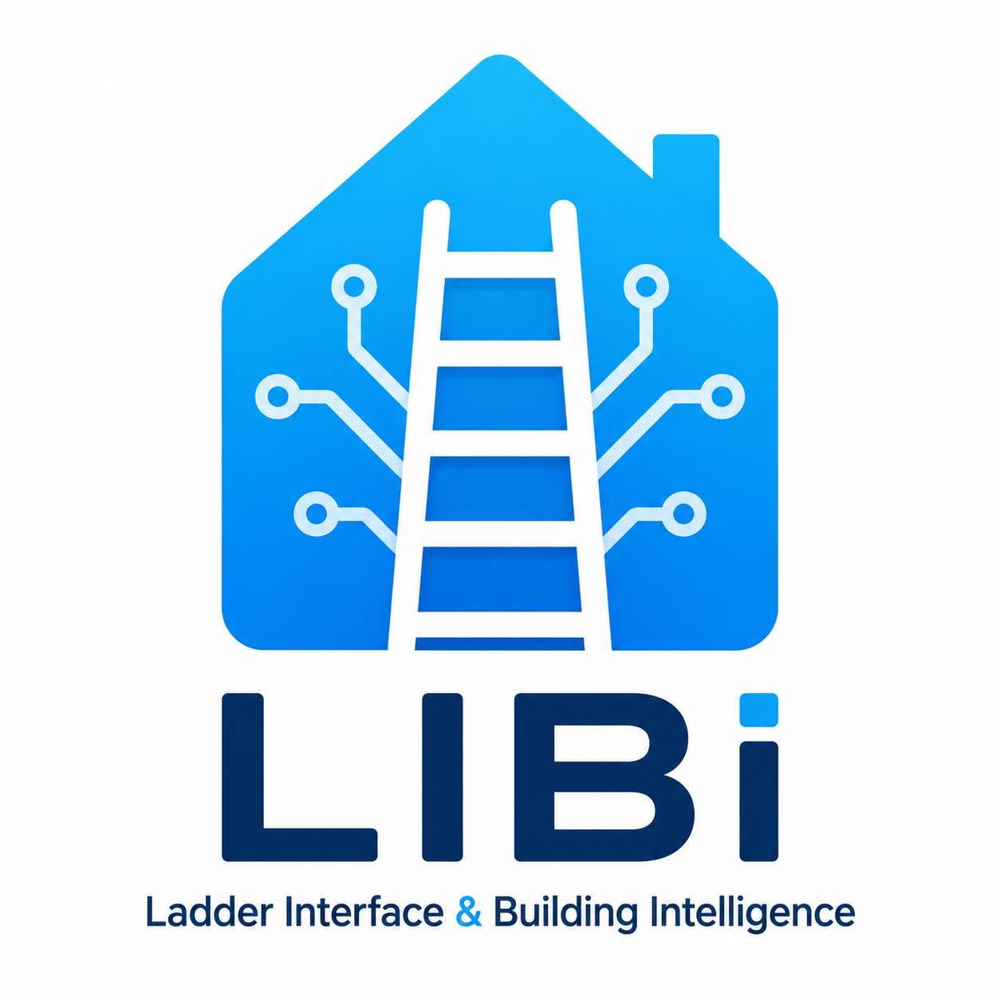
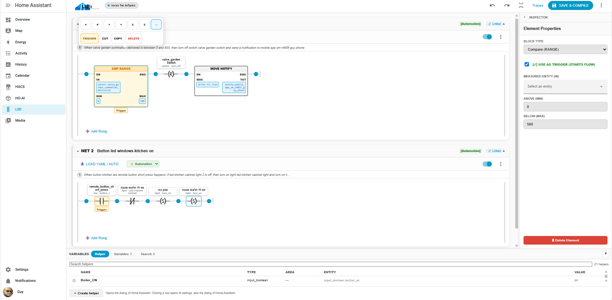
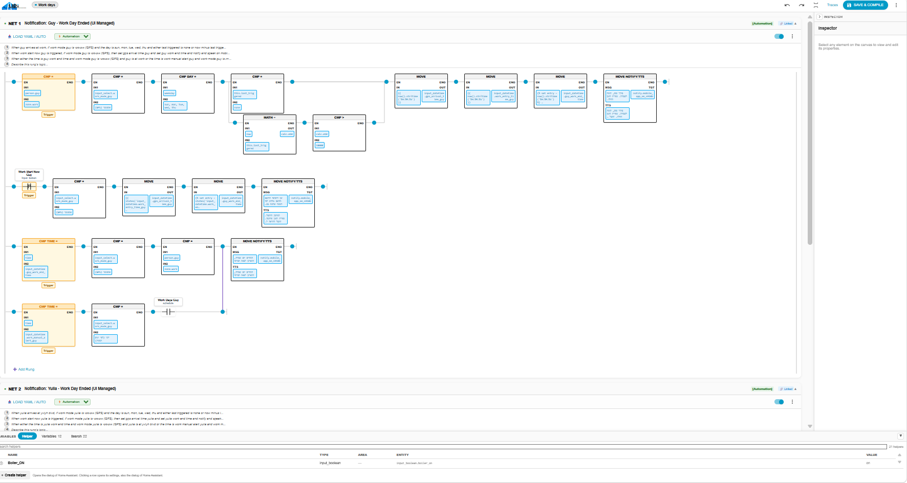

  

# **LIBI (Ladder Interface & Building Intelligence)**

  
  
  

  
  
  
  

## **Why LIBI**

I have been a PLC programmer and IT professional for 25 years.

When I moved my home to Home Assistant, the one thing I really missed was **Ladder logic**: the language I think in when I design control logic. Home Assistant has YAML, the visual editor and Node-RED, but no Ladder. So I built LIBI.

## **Not a Node-RED Replacement**

**Please note:** LIBI is *not* intended to replace Node-RED. It is simply an alternative approach to writing automations in Home Assistant. It is specifically designed for electricians, PLC (Programmable Logic Controller) programmers, or anyone who prefers a straightforward, graphical way to learn and write logic.

## **What is LIBI?**

LIBI is a graphical editor that takes your existing Home Assistant automations and automatically translates them into a LADDER logic representation. It allows you to:

* Add and modify automation logic using a visual interface.  
* Save the resulting logic directly back to standard Home Assistant YAML files.  
* Execute the automations natively within Home Assistant, just like any standard automation.

### **IEC 61131-3 Compliance**

The software is built upon the **IEC 61131-3** standard, the international standard defining programming languages for PLCs. Specifically, LIBI utilizes:

* **LD (Ladder Diagram):** The classic ladder logic format, adapted with minor deviations to ensure seamless compatibility with Home Assistant's native entities and execution models.

## **Key Features**

* **Integrated Helper Management:** Search for, manage, and insert variables (Helpers) directly from within the graphical editor.  
* **Project and File Grouping:** Save and manage groups of YAML files collectively. In LIBI, every **NET** functions as an individual YAML file. This allows you to open a single project and view all related ladders (e.g., "Garden Automations", "Security Automations") in one unified workspace.
* **Net Versions:** Every NET keeps its earlier versions. Opening a project records **V1**, and every **SAVE & COMPILE** that changes a NET records the next one (V2, V3, ...). The **V** badge on a NET shows the version that runs in Home Assistant; click it to see every version with its date and YAML, put an earlier one back on the canvas, and **SAVE & COMPILE** to make it the one that runs. Without a choice, the newest saved version runs. A change made in Home Assistant's own editor is recorded as a version the next time the project is opened.

## **Installation**

**Requirements:** Home Assistant 2025.1 or newer, [HACS](https://hacs.xyz/), and an administrator account. LIBI edits your automations, so like Home Assistant's own automation editor it is available to administrators only.

> [!TIP]
> **No YAML configuration is needed.** LIBI is set up entirely from the Home Assistant UI. You do not add anything to `configuration.yaml`, and there is no `!include` line to write: LIBI works with the `automations.yaml`, `scripts.yaml` and `scenes.yaml` that every Home Assistant installation already has.

### With HACS (recommended)

The quickest way is the two buttons below. Each one opens the right page in your own Home Assistant:

Or step by step:

1. **Add the repository to HACS.** LIBI is a custom repository, so HACS needs to be told where it is once.
   - Open **HACS** in the sidebar.
   - Open the menu (**⋮**, top right) and choose **Custom repositories**.
   - In **Repository**, enter `https://github.com/GuyAzria/Libi`.
   - In **Type**, choose **Integration**, and click **Add**.
2. **Download LIBI.**
   - In HACS, search for **LIBI** and open it.
   - Click **Download** (bottom right), keep the latest version, and click **Download** again.
3. **Restart Home Assistant.** Go to **Settings ▸ System**, click the power icon (top right), and choose **Restart Home Assistant**. HACS also shows a *Restart required* notice under **Settings**.
4. **Add the integration.**
   - Go to **Settings ▸ Devices & services**, click **Add integration**, and search for **LIBI**.
   - When asked for the **AI mode**, choose **No AI**. The AI features are not released yet; this can be changed later.

**LIBI** now appears in the sidebar. Open it, and your existing automations are ready to be loaded as ladder diagrams.

### Updating

When a new version is released, HACS shows it under **Settings** as an available update. Install it there and restart Home Assistant. Your projects in `config/libi/` and your automations are kept.

### Manually

Download `libi.zip` from the [latest release](https://github.com/GuyAzria/Libi/releases/latest), unpack it into `config/custom_components/libi/`, restart Home Assistant, and add the integration as in step 4. With a manual install, HACS does not tell you about updates.

## **What LIBI changes in your configuration**

* LIBI reads and writes the same `automations.yaml`, `scripts.yaml` and `scenes.yaml` that Home Assistant's own editors use, and reloads them after a save. Nothing has to be added to `configuration.yaml`.
* Entries you wrote yourself, by hand or in the Home Assistant editor, are kept exactly as they are. A file is only written when its content actually changes.
* If one of those files cannot be read (for example because it contains a syntax error), LIBI saves nothing and tells you why.
* Projects are stored as `.libi` files in `config/libi/`, so they are part of your Home Assistant backup.
* The version history of each project is stored next to it, as `<project>.versions.json` (up to 30 versions per NET; the one that runs is always kept). Deleting a project deletes its history; the automations stay in Home Assistant.

## **🤖 AI Chat (beta)**

Under the Inspector, the **AI Chat** builds ladder logic from a sentence, in your own language — for example *"pressing a button turns the living room light on for 10 minutes"*.

You can also ask about the nets on the page ("what does the garden net do?") or ask to change one ("water on Sunday, Tuesday, Thursday and Saturday at 5:00 instead of the button"). A change is drawn as a new version that you can put in place of the old net with **Replace NET**.

1. LIBI asks the AI what the logic needs, then **searches your Home Assistant itself** and shows you the matching devices — every button, every light in the living room. You pick them, several at once if you like.
2. You answer the few questions it asks (how long, which days, whether you want a dashboard card).
3. You get a **draft NET** to add to the canvas, plus a dashboard card to copy if you asked for one.

**The AI never chooses or controls a device on its own.** It only ever sees roles like "the buttons" and "the lights"; the entities are the ones *you* ticked. LIBI rejects any draft that names another entity, a device or area id, or a service outside a safe list, and Home Assistant's own validator checks it too. Nothing is written until you press **SAVE & COMPILE**, and drafts that control locks, alarms, covers, valves or sirens are flagged.

**Privacy:** what you type in the chat and the *names* of the devices you pick are sent to the AI model you choose. While **Share the nets on this page and my helpers** is on (it is by default), the chat also sends the nets open in the LIBI page (as YAML), your helpers, and the devices that match the request with their state and unit, so it can answer questions about those nets, change them and reuse what you already have. Your other automations - the rest of `automations.yaml`, `scripts.yaml` and `scenes.yaml` - and the rest of your devices are never sent. With **Local AI**, everything stays on your own server.

**Setup:** Settings ▸ Devices & services ▸ LIBI ▸ **Configure**, then choose:

* **Local AI** — an [Ollama](https://ollama.com) server address and model; nothing leaves your home.
* **Cloud API** — Google Gemini, OpenAI, or any OpenAI-compatible service, with its API key and model.

Made with ❤️ for the Home Assistant community by Guy Azria
